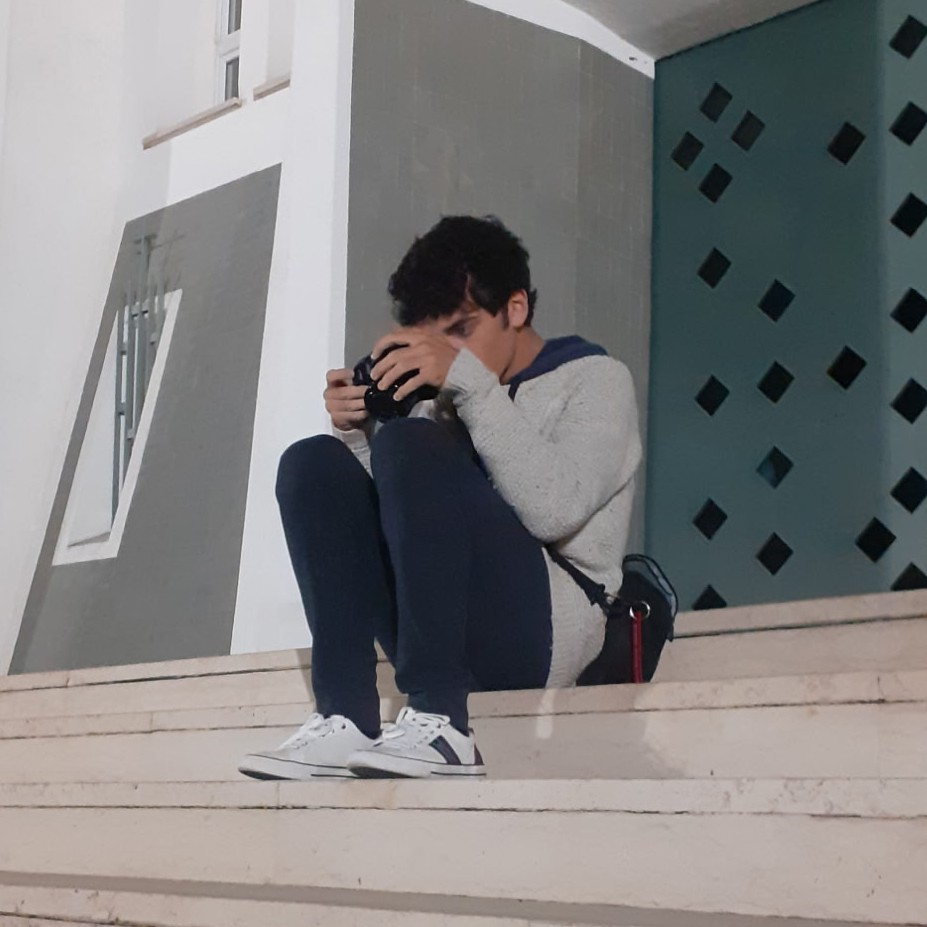

<header>
	

	<h1>{{ site.contact.name }}</h1>
	
	
</header>

<main style="max-width: min(100%, 90ch);">

<section style="background-color: #696932">
	<h2>(!)</h2>
	alcune pagine "Altri dettagli" sono ancora in costruzione
</section>

	<h3>Istruzione & Certficazioni</h3>
	<table>
		<tr>
			<td><h4>Diploma di maturità scientifica</h4>
			Liceo "Giuseppe Moscati" di Grottaglie: indirizzo scienze applicate</td>
			<th class="accent">100/100</th>
		</tr>
		<tr>
			<td><h4>Certificazione linguistica</h4>
			Cambridge English FIRST</td>
			<th class="accent">C1</th>
		</tr>
		<tr>
			<td><h4>Patente di guida</h4></td>
			<th class="accent">B</th>
		</tr>
	</table>

	<h3>Competenze, Skills</h3>
	<section>
		<h3>Informatica</h3>
		<ul class="accordion-ani">
			

				
<header class="left">
						
						<h3>Sistemi operativi</h3>
						</header>

				<table>
					<tr><td>Windows</td></tr>
					<tr><td>GNU/Linux</td></tr>
				</table>
			

			

				
<header class="left">
						
						<h3>Programmazione e Sviluppo App</h3>
						</header>

				<table>
					<tr><td><a href="https://github.com/{{ site.contact.github }}?tab=repositories&q=&type=&language=python">Python</a></td></tr>
					<tr><td><a href="https://github.com/{{ site.contact.github }}?tab=repositories&q=&type=&language=c%23">C#</a></td></tr>
					<tr><td><a href="https://github.com/{{ site.contact.github }}?tab=repositories&q=&type=&language=javascript">Javascript</a></td></tr>
					<tr><td><a href="https://github.com/s7uck-ITA/s7uck-ITA.github.io/blob/master/_plugins/photo_gen.rb">~Ruby</a></td></tr>
					<tr><td><a href="https://github.com/{{ site.contact.github }}/PowerPage">Windows Forms / Univerasal Windows Platform</a></td></tr>
				</table>
			

			

				
<header class="left">
						
						<h3>Strumenti informatici</h3>
						</header>

				<table>
					<tr><td><a href="https://github.com/{{ site.contact.github }}">Git</a></td></tr>
					<tr><td>Microsoft Office</td></tr>
					<tr><td>Libreoffice</td></tr>
					<tr><td>SQL</td></tr>
					<tr><td>Shell Scripting e Automazione / CI-CD</td></tr>
					<tr><td>Sublime Text</td></tr>
				</table>
			

		</ul>
	</section>
	<section>
		<h3>Design & Grafica</h3>
		<ul class="accordion-ani">
			

				
<header class="fully-spaced">
								<h3>Web Design</h3>
								
								</header>

				Costruzione di siti web graficamente avanzati anche solo con HTML e CSS, Apache, express.Js o Jekyll

				<h3>esempi</h3>
				<ul class="scroll coverflow">
					<section class="tight">
						
						<figcaption>
							<table>
								<tr>
									<td><h4>APOD Viewer</h4></td>
									<th class="accent"></th>
								</tr>
							</table>
						</figcaption>
					</section>
				</ul>
			

			

				
<header class="fully-spaced">
								<h3>Graphic Design, Progettazione</h3>
								
								</header>

				Grafiche promozionali, sfondi, loghi e packaging da zero
			

			

				
<header class="fully-spaced">
								<h3>Interface Design e Prototipazione</h3>
								
								</header>

				Creo UI Concepts da quando ho memoria, iniziando su PowerPoint, adesso in modo strutturato con Figma e Prototypes. Anche App Windows via uWP
			

		</ul>
	</section>
	<section>
		<h3>Fotografia & Videomaking</h3>
		<ul class="accordion-ani">
			

				
<header class="left">
						
						<h3>Concetti</h3>
						</header>

				<table>
					<tr><td>Regole di composizione</td></tr>
					<tr><td>Scatto manuale</td></tr>
					<tr><td>Elaborazione foto RAW</td></tr>
					<tr><td>L-Cut, jump cut, animazioni</td></tr>
					<tr><td>Node based video editing</td></tr>
				</table>
			

			

				
<header class="left">
						
						<h3>Software per fotografia</h3>
						</header>

				<table>
					<tr><td>Darktable</td></tr>
					<tr><td>EXIFtool</td></tr>
				</table>
			

			

				
<header class="left">
						
						<h3>Software per video editing</h3>
						</header>

				<table>
					<tr><td>VSDC Video Editor</td></tr>
					<tr><td>Olive</td></tr>
					<tr><td>Kdenlive</td></tr>
					<tr><td>FFmpeg</td></tr>
				</table>
			

		</ul>
	</section>

	<h3>Portfolio</h3>
	<ul class="scroll snap coverflow">
		<section class="snap bg" id="{{ project.slug }}">
			
			<header class="fully-spaced nowrap">
			<h3>{{ project.title }}</h3>
			
			</header>
			{{ project.desc }}
		</section>
	</ul>

	<h3>Dimensioni di me</h3>
	<ul class="accordion-ani">
		

			
<h3>Aviazione</h3>

			Tutto ciò che vola fa i miei sogni fin da quando ero piccolo. 
		

		

			
<h3>Tecnologia e Informatica</h3>

			Ho imparato da autodidatta negli anni a usare professionalmente il computer per
			programmazione, grafica, video editing e creazione siti web.
		

		

			
<h3>Fotografia</h3>

			Sono da lungo tempo appassionato di fotografia. Mi piace catturare in particolar modo paesaggi, ma anche scatti più avanzati come quelli al cielo notturno.
		

		

			
<h3>Design</h3>

			Disegnare e “immaginare cose” mi permette di dare sfogo a una creatività interiore, che mi spinge a ripensare esteticamente o tecnicamente ciò che uso. Diversi anni fa mi sono avvicinato al graphic design, e successivamente all’interface design, product design, web design, e in generale al design artistico e tecnico (anche interior, urban, transport etc).
			  Il design è il mezzo dell'interazione tra umano e strumento, o umano e ambiente. Dev'essere quindi in un certo senso “stoico” rispetto all’utente, ma contemporaneamente consapevole del fine dell'oggetto o del sistema: cioè il design richiede attenzione e lungimiranza oltre che un buon senso estetico. Ho iniziato da piccolo a creare concept di sistemi operativi, pagine web semplici imparando l’HTML e il CSS, e occasionalmente grafiche promozionali come locandine o banner. Con il tempo ho affinato molto questa abilità, a partire da nozioni tecniche, per poi arrivare a creare design originali partendo da concetti nuovi.
		

		

			
<h3>Musica</h3>

			Ho iniziato ad interessarmi attivamente di musica solo da pochi anni, esplorando cioè dei generi, e provando a produrre qualcosa. In termini di gusti musicali non sono molto originale per la mia età. Ascolto perlopiù rap e hip hop, mentre per la musica strumentale, techno e house tra le altre cose. Molti giudicano la musica della mia generazione come superficiale, ma non è così, infatti tra i miei artisti preferiti figurano delle penne che fanno invidia anche ad artisti internazionali. Come ogni corrente artistica se ne può dire di tutto, ma comunque si studierà nei libri di scuola.
		

		

			
<h3>Il mondo</h3>

			Intendo comprendere a fondo i meccanismi che regolano le nostre società. Ho
			approfondito già da prima delle superiori dei temi di economia, e successivamente ho
			maturato interesse per tutto ciò che riguarda la geopolitica, la storia, la comunicazione e
			l'espressione culturale dei singoli individui e dei popoli. Mi appassionano, ad esempio, la
			musica, l'architettura e la letteratura.
		

	</ul>

	<h3>Attività sociali e politiche</h3>
	<table>
		<tr>
			<td>2026</td>
			<td><h4>Premio "Alessandro Leogrande" · Taranto</h4>
			
Il premio "Alessandro Leogrande", intitolato a un giornalista mio concittadino scomparso
			nel 2017, è un premio rilasciato su base annuale a libri di giornalismo narrativo.
			Quest'anno ho partecipato alla votazione leggendo "Quando il mondo dorme" di
			Francesca Albanese, relatrice ONU per la questione palestinese, e ho contribuito nel mio piccolo alla sua premiazione.
</td>
			<th class="accent"><a href="/showcase/leogrande.html">Altri dettagli</a></th>
		</tr>
		<tr>
			<td>2017</td>
			<td><h4>AEDE - Ambasciatori d'Europa 2018 · Ceglie Messapica</h4>
			
Primo premio "Giuseppe Tramarollo" scuole primarie e attestato di merito eccezionale.
			L'obiettivo del concorso era immaginare un percorso attraverso il quale potesse
			realizzarsi una vera unione europea. Ho partecipato presentando il logo e il video promo,
			in lingua inglese, di un'ipotetica tv europea "eu 1 tv" con palinsesti che incentivassero nei
			cittadini un sentimento di appartenenza e fratellanza europea.
</td>
			<th class="accent"><a>Altri dettagli</a></th>
		</tr>
	</table>

	<h3>Volontariato</h3>
	<table>
		<tr>
			<td>6/2025</td>
			<td><h4>3ª Passeggiata di Solidarietà</h4>
			
Passeggiata di 4 km a sostegno del reparto di Oncoematologia Pediatrica a Taranto, con
			destinazione Aeroporto di Grottaglie.
</td>
		</tr>
		<tr>
			<td>9/2025+</td>
			<td><h4>OpenStreetMap</h4>
			
OpenStreetMap è una mappa del mondo libera all'uso e apertamente modificabile. Dal
			2025 modifico assiduamente la mappa tentando il più possibile di completarla con ciò che
			conosco della mia zona.
</td>
			<th class="accent"><a href="/showcase/osm.html">Altri dettagli</a></th>
		</tr>
		<tr>
			<td>3/2026</td>
			<td><h4>Iscrizione a ADMO (Associazione Donatori di Midollo Osseo)</h4></td>
			<th class="accent"><a href="https://admo.it/">Altri dettagli</a></th>
		</tr>
	</table>

	<h3>Relazionarsi</h3>
	<!-- android -->
	<table>
		<thead>
			<th><h3>i miei pregi</h3></th>
			<th><h3>i miei difetti</h3></th>
		</thead>
		<tr>
			<td>Creo le tabelle</td>
			<td>Non le riempio</td>
		</tr>
	</table>

<!--


	<h3>{{ div.title }}</h3>
	<table>
		<tr>
			<td><h4>{{ row.h }}</h4>
			{{ row.text }}</td>
			<th class="accent">{{td}}</th>
			<th class="accent"><a href="{{ row.link[1] }}">{{ row.link[0] }}</a></th>
		</tr>
	</table>


-->
</main>

<!--footer>
	<nav>
		<menu class="vertical">
			<li>ciao</li>
			<li>ciao</li>
			<li>ciao</li>
			<li>ciao</li>
			<li>ciao</li>
			<li>ciao</li>
		</menu>
	</nav>
</footer-->

